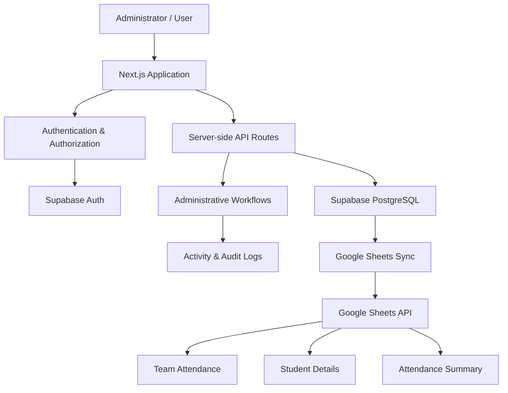

# 🏆 Project Showcase 3.0

> **Team Showcase, Verification & Administrative Management Platform** — A full-stack university project management platform built with Next.js, TypeScript, and Supabase. Designed to manage participant teams, student information, administrative verification workflows, attendance checkpoints, and centralized event operations.

---

## ⚡ Overview

**Project Showcase 3.0** is a centralized platform for managing university project showcase operations. It brings team information, student records, administrative verification, and attendance management into one system.

The application provides separate experiences for administrators based on their assigned roles and responsibilities.

### Core Application Modules

- **Team Management:** Centralized access to registered teams, team leaders, members, and institution information.
- **Attendance Management:** Track administrative checkpoints for every participating team.
- **Admin Management:** Create and manage administrator accounts, roles, access permissions, and desk assignments.
- **Verification Workflow:** Record and track team verification activities.
- **Activity Logs:** Maintain a historical record of administrative actions.
- **Google Sheets Integration:** Synchronize team, student, and attendance information with Google Sheets.

---

## 🎯 Key Features

### 1. Administrative Dashboard

A centralized workspace providing administrators with access to the tools and information required for event operations.

- Overview of team records and administrative activity.
- Organized navigation across management modules.
- Access-controlled administrative workspace.
- Role-based access restrictions.

### 2. Team Management

A centralized system for viewing and managing participating teams.

- Team identification and registration information.
- Team names and institutional details.
- Team leader information.
- Student and member information.
- Searchable and filterable team records.
- Internal and External team classification.

### 3. Attendance Management

A checkpoint-based attendance and verification workflow.

Each team has three administrative checkpoints:

| Checkpoint | Description |
|---|---|
| Reported | Records whether the team has reported. |
| Identity (ID Card) | Records completion of identity verification (column `photo_id_checked`). |
| NOC Verification | Records whether the required NOC has been received (external teams only; column `noc_received`). |

**Attendance Status Calculation:**

- **Not Started:** 0 out of 3 checkpoints completed.
- **In Progress:** 1 or 2 checkpoints completed.
- **Completed:** All 3 checkpoints completed.

Additional functionality:

- Filter teams by All, Internal, and External.
- Filter by checkpoint completion status.
- Update individual checkpoint records.
- Track which administrator performed verification actions.
- View progress across participating teams.
- Paginated team listing.

### 4. Admin Management

A dedicated administrator management system controlled by Super Administrators.

**Supported roles:**

| Role | Responsibilities |
|---|---|
| Super Admin | Full administrative control and administrator management. |
| Admin | Access to assigned administrative workspace. |

**Desk Assignment:**

Regular administrators can be assigned to one of two desks:

- **Internal**
- **External**

Super Administrator accounts do not require a desk assignment.

**Account Management Features:**

- Create administrator accounts directly.
- Enter administrator name, email, and initial password.
- Assign Admin or Super Admin role.
- Assign Internal or External desk to regular administrators.
- Enable or disable sign-in access.
- Update administrator details.
- Change roles and desk assignments.
- Reactivate or deactivate accounts.
- Protect the last active Super Administrator account.

Administrator accounts are created through Supabase Authentication and linked to their corresponding administrator profiles.

### 5. Activity Logs & Audit Trail

The platform maintains an administrative audit trail to support accountability and traceability.

- Record administrative actions.
- Track the administrator responsible for an action.
- Maintain action timestamps.
- Record relevant target account and activity details.
- Track administrator creation, profile changes, role changes, desk changes, and access changes.
- Preserve historical audit records.

Audit records are protected against unauthorized modification and deletion.

### 6. Google Sheets Synchronization

Project Showcase supports synchronization with Google Sheets using a Google Cloud Service Account.

The integration is designed to keep important event information accessible through dedicated spreadsheets.

**Supported spreadsheet tabs:**

| Sheet | Purpose |
|---|---|
| Team Attendance | Team information and attendance checkpoints. |
| Student Details | Student and participant information. |
| Attendance Summary | Consolidated attendance and checkpoint status. |

**Integration Features:**

- Google Sheets API integration.
- Service-account authentication.
- Spreadsheet synchronization.
- Separate datasets for teams, students, and attendance.
- Sync job tracking.
- Pending and failed sync job monitoring.

Google service-account credentials are handled through server-side environment variables.

---

## 🔐 Authentication & Security

Authentication and administrative access are powered by Supabase.

Security considerations include:

- Supabase Authentication for administrator sign-in.
- Role-based authorization.
- Internal and External desk separation.
- Server-side administrative operations.
- Protected administrative API routes.
- Supabase Row Level Security (RLS).
- Secure handling of service credentials.
- Audit logging for sensitive administrative operations.
- Protection against unauthorized account management.

**Important:** Supabase service-role or secret keys and Google service-account private keys must never be exposed in client-side code or committed to GitHub.

---

## 🎨 Design & User Experience

The platform follows a modern administrative dashboard approach focused on clarity, usability, and efficient event operations.

Design priorities include:

- Structured dashboard layouts.
- Clear navigation and information hierarchy.
- Data-focused tables and management interfaces.
- Responsive layouts for different screen sizes.
- Consistent status indicators.
- Accessible administrative workflows.
- Clear separation of administrative responsibilities.

---

## 🛠️ Technology Stack

| Technology | Purpose |
|---|---|
| [Next.js](https://nextjs.org/) | Full-stack React framework |
| [React](https://react.dev/) | User interface |
| [TypeScript](https://www.typescriptlang.org/) | Type safety |
| [Tailwind CSS](https://tailwindcss.com/) | Styling |
| [Supabase](https://supabase.com/) | PostgreSQL database and authentication |
| [Supabase Auth](https://supabase.com/docs/guides/auth) | Administrator authentication |
| [Google Sheets API](https://developers.google.com/workspace/sheets/api) | Spreadsheet synchronization |
| [Google Cloud](https://cloud.google.com/) | Service-account authentication |
| [Lucide](https://lucide.dev/) | Icons |

---

## 🏗️ System Architecture

Project Showcase follows a full-stack application architecture.



### Architecture Components

- **Frontend:** Next.js and React-based application.
- **Backend:** Next.js server-side API routes and server components.
- **Authentication:** Supabase Auth.
- **Database:** Supabase PostgreSQL.
- **Authorization:** Role-based and desk-based access control.
- **External Integration:** Google Sheets API.
- **Audit System:** Administrative activity logging.

---

## 🗄️ Database & Data Management

The application uses PostgreSQL through Supabase.

Important database entities include:

| Entity | Purpose |
|---|---|
| `admin_profiles` | Administrator identities, roles, access status, and desk assignments. |
| `admin_audit_logs` | Historical administrator management activity. |
| `team_verifications` | Team verification and checkpoint information. |
| `verification_audit_logs` | Historical verification activity. |
| Supabase Auth Users | Authentication identities and credentials. |

The database uses relational constraints, foreign keys, and security policies to maintain data integrity and control access.

Additional tables support the application's team and student information workflows.

---

## 📁 Project Structure

The project is organized around Next.js App Router conventions.

```text
Project Showcase/
│
├── app/
│   ├── admin/
│   │   └── ...                    # Administrative workspace
│   │
│   ├── api/
│   │   └── admin/
│   │       └── ...                # Administrative API routes
│   │
│   ├── auth/
│   │   └── ...                    # Authentication routes
│   │
│   ├── globals.css                # Global styles
│   ├── layout.tsx                 # Root application layout
│   └── page.tsx                   # Application entry page
│
├── components/
│   └── ...                        # Reusable UI components
│
├── lib/
│   ├── auth/
│   │   └── admin.ts               # Administrative authorization
│   └── ...                        # Application utilities and clients
│
├── public/                        # Static assets
│
├── .env.example                   # Environment variable template
├── .gitignore
├── next.config.mjs
├── package.json
├── tsconfig.json
└── README.md
```

*Note: This is a high-level structural overview, not an exhaustive file listing.*

---

## ⚙️ Getting Started

### Prerequisites

Install the following before running the application:

- Node.js
- npm
- Git
- A Supabase account
- A Google Cloud project (required for Google Sheets synchronization)

### 1. Clone the Repository

```bash
git clone https://github.com/AyushDey10/project-showcase.git

cd project-showcase
```

### 2. Install Dependencies

```bash
npm install
```

### 3. Configure Environment Variables

Create a `.env.local` file in the project root.

```env
# Supabase Configuration
NEXT_PUBLIC_SUPABASE_URL=your_supabase_project_url
NEXT_PUBLIC_SUPABASE_PUBLISHABLE_KEY=your_supabase_publishable_key
SUPABASE_SECRET_KEY=your_supabase_secret_key

# Google Sheets Configuration
GOOGLE_SHEETS_SPREADSHEET_ID=your_spreadsheet_id
GOOGLE_SERVICE_ACCOUNT_EMAIL=your_service_account_email
GOOGLE_PRIVATE_KEY="your_google_service_account_private_key"
```

Replace the placeholder values with your actual credentials.

**Security requirements:**

- Never commit `.env.local` to GitHub.
- Never expose `SUPABASE_SECRET_KEY` in browser-side code.
- Never expose `GOOGLE_PRIVATE_KEY` in browser-side code.
- Use server-side environment variables for privileged operations.
- Use separate credentials for local development and production where appropriate.

### 4. Run the Development Server

```bash
npm run dev
```

Open:

```text
http://localhost:3000
```

The application will be available locally.

---

## 📜 Available Commands

| Command | Description |
|---|---|
| `npm install` | Install project dependencies. |
| `npm run dev` | Start the local development server. |
| `npm run build` | Create a production build. |
| `npm run start` | Start the production server. |
| `npx tsc --noEmit` | Run TypeScript type checking. |

---

## 🚀 Deployment

### Deploy with Vercel

Project Showcase is designed to be deployed on [Vercel](https://vercel.com/).

**Deployment process:**

1. Push the project repository to GitHub.
2. Sign in to Vercel using GitHub.
3. Import the `project-showcase` repository.
4. Select Next.js as the framework.
5. Configure the required environment variables.
6. Deploy the application.
7. Verify authentication, database connectivity, and administrative workflows.

**Recommended build command:**

```bash
npm run build
```

The build script should use the project's configured Next.js build command.

### Production Configuration

Before deployment, verify:

- All required environment variables are configured.
- Supabase production credentials are valid.
- Google Sheets credentials are valid.
- The production domain is configured in Supabase Auth URL settings.
- Authentication redirect URLs are correct.
- Database RLS policies are enabled and tested.
- Server-side API routes work correctly.
- No secret credentials are committed to GitHub.

---

## 🔄 Development Workflow

The recommended development workflow is:

```text
Local Development
       |
       v
Code Changes
       |
       v
TypeScript Validation
       |
       v
Production Build
       |
       v
Git Commit & Push
       |
       v
GitHub Repository
       |
       v
Vercel Deployment
       |
       v
Production Testing
```

---

## 📌 Project Goals

Project Showcase aims to provide:

- Centralized team and student information management.
- Efficient administrative verification workflows.
- Transparent attendance tracking.
- Secure role-based administrator access.
- Clear separation of Internal and External responsibilities.
- Reliable administrative audit records.
- Convenient Google Sheets synchronization.
- A maintainable and scalable application architecture.

---

## 👨‍💻 Development

**Project:** Project Showcase 3.0  
**Repository:** [AyushDey10/project-showcase](https://github.com/AyushDey10/project-showcase)  
**Framework:** Next.js  
**Backend & Database:** Supabase  
**Deployment Platform:** Vercel

---

## 📄 License

This repository is intended for the Project Showcase event and its associated administrative operations.

License and usage permissions are subject to the repository owner's terms.
